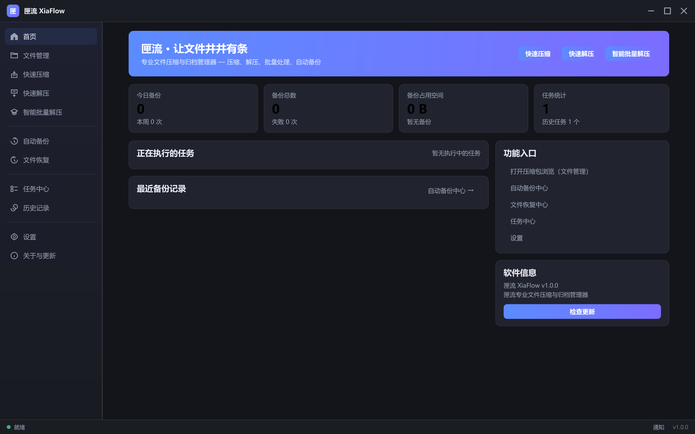
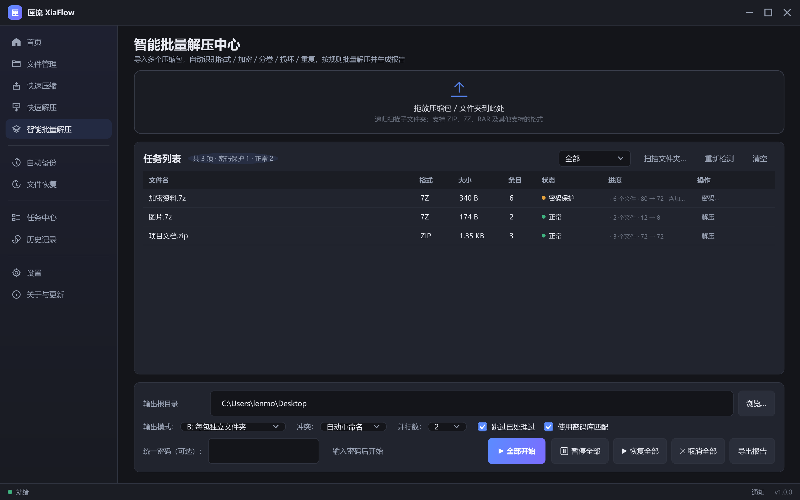

<div align="center">

# 匣流 XiaFlow

**专业文件压缩与归档管理器 · XiaFlow Archive Manager**

现代化的 Windows 专业压缩、解压、文件管理、批量处理与自动备份软件

`v1.0.0` · Windows 10/11 x64 · [.NET 10 WPF](https://dotnet.microsoft.com) · [7-Zip 26.06 引擎](https://www.7-zip.org)

</div>

---

## 软件介绍

匣流（XiaFlow）是一款集**文件压缩、文件解压、压缩包管理、批量处理、自动备份、文件校验、任务调度、右键菜单和自动更新**于一体的专业级 Windows 桌面软件。UI 与压缩引擎完全分离（7z.exe 独立进程 + LZ4 管理实现），后台任务统一调度，支持深色 / 浅色双主题。

## 最新更新

### v1.0.0 · 2026-11-18

匣流首个正式版，提供压缩与解压、批量处理、压缩包管理、自动备份与恢复、统一任务中心和 Windows 系统集成。

完整发布记录见[更新说明](docs/releases/release-notes.md)，安装包与便携版见 [GitHub Releases](https://github.com/yuchen0x1/XiaFlow/releases)。

## 功能展示（真实运行截图）

| 首页 | 智能批量解压中心 |
|---|---|
|  |  |

> 截图目录中的「智能批量解压中心」为导入真实压缩包后的自动检测结果：格式 / 大小 / 条目数 / 加密状态一目了然。

更多截图：[压缩界面](docs/screenshots/02-压缩界面.png) · [解压界面](docs/screenshots/03-解压界面.png) · [压缩包内部管理](docs/screenshots/05-压缩包内部管理.png) · [自动备份中心](docs/screenshots/06-自动备份中心.png) · [文件恢复中心](docs/screenshots/07-文件恢复中心.png) · [任务中心](docs/screenshots/08-任务中心.png) · [历史记录](docs/screenshots/09-历史记录.png) · [设置中心](docs/screenshots/10-设置中心.png) · [关于与更新](docs/screenshots/11-关于与更新.png)

## 核心特色

### 三大特色功能

1. **智能批量解压中心** —— 一次拖入多个压缩包（或递归扫描整个文件夹），自动识别并分类：正常 / 密码保护 / 分卷 / 损坏 / 不支持 / 重复 / 已处理过；提供 6 种输出模式（指定目录 / 每包独立文件夹 / 按归档结构 / 按类型分类 / 只提取指定类型 / 只提取匹配文件名）、冲突处理策略、密码库自动匹配、逐项暂停恢复取消、并行执行，完成后生成可导出（TXT / CSV）的报告。
2. **压缩包内部文件管理中心** —— 不解压直接浏览压缩包内部（7Z/ZIP/TAR/GZ/BZ2/XZ/WIM/ISO/CAB/CPIO/RPM/DEB/RAR 等），支持目录导航、搜索、排序、单文件/目录提取、安全预览（文本 / 代码 / JSON / XML / 图片，8MB 大小限制，绝不执行包内程序）、SHA-256 校验、完整性测试；对 7Z / ZIP / TAR 支持添加、删除、重命名等内部修改。
3. **自动备份与压缩中心** —— 多任务独立策略：完整 / 增量 / 差异备份、真实备份链（manifest 索引 + Chain 依赖）、Windows 任务计划程序可靠调度（软件未打开也能备份）、启动补跑遗漏任务、密码库加密（DPAPI）、备份后自动校验、保留策略清理（天数 / 数量，删除前依赖检查，绝不触碰源文件）、备份历史统计与文件恢复中心（恢复到原位置 / 新位置、覆盖前清单确认）。

### 更多能力

- **快速压缩 / 快速解压**：拖放式操作，6 档压缩等级、AES-256 加密、加密文件名（7Z）、分卷、字典大小、线程数、排除规则、压缩后完整性测试
- **统一任务中心**：压缩 / 解压 / 批量 / 校验 / 备份 / 恢复任务统一排队，并行限制、暂停（进程级挂起）/ 恢复 / 取消 / 重试、真实进度 / 速度 / 剩余时间、历史记录
- **Windows 集成**：右键菜单（用户级注册表，Win10/11 有效）、「打开方式」候选注册、开机启动、系统托盘、气泡通知
- **自动更新**：GitHub Releases 更新源，SHA-256 校验通过后才执行安装，校验失败绝不运行未验证文件；支持 stable / beta 通道与跳过版本
- **安全防线**：Zip Slip 路径穿越防护、绝对路径拒绝、非法字符清洗、保留名中和、符号链接跳过、压缩炸弹（总量 / 单文件 / 文件数上限）、磁盘空间预检、密码 DPAPI 加密存储（绝不明文 / 绝不入日志）
- **双主题**：精致深色科技风 + 完整浅色主题，支持跟随系统

## 支持格式（诚实声明）

| 能力 | 格式 |
|---|---|
| 解压（读取） | 7z, zip, rar (RAR1–5，仅解压), tar, gz, bz2, xz, zst, lz4, lzma, wim, swm, esd, iso, cab, cpio, rpm, deb, arj, lzh, chm, msi, dmg, vhd, vdi, squashfs, udf, ntfs, fat, ext, split (.001) 等 |
| 创建 | 7z, zip, tar, gz, bz2, xz, wim, lz4 |
| 修改内部文件 | 7z, zip, tar |
| 加密创建 | 7z（AES-256 + 可加密文件名）、zip（AES-256） |
| 分卷 | 7z / zip 创建与解压 |

> 受 unRAR 授权限制，匣流**不提供 RAR 创建**功能（仅解压），并如实标注于界面与许可文件中。

## 安装方法

### 安装版（推荐）

1. 从 [GitHub Releases](https://github.com/yuchen0x1/XiaFlow/releases) 下载 `XiaFlow-1.0.0-setup-x64.exe`
2. 运行安装向导：自定义安装路径、桌面快捷方式、右键菜单与「打开方式」候选均为可选项
3. 用户级安装（无需管理员权限）；卸载保留用户备份数据（`%APPDATA%\XiaFlow`）

### 便携版

1. 从 [GitHub Releases](https://github.com/yuchen0x1/XiaFlow/releases) 下载 `XiaFlow-1.0.0-portable-x64.zip` 并解压到任意目录
2. 运行 `XiaFlow.exe` 即可，无需安装；数据目录仍位于 `%APPDATA%\XiaFlow`（配置 / 备份索引 / 密码库）

## 使用教程

- **快速压缩**：左侧导航 → 快速压缩 → 拖入文件 / 文件夹 → 选择格式与等级 →（可选）设置密码 → 开始压缩
- **快速解压**：拖入压缩包（分卷拖入首卷）→ 选择解压位置 → 输入密码（若加密，密码库可自动匹配）→ 开始解压
- **批量解压**：拖入多个压缩包或文件夹 → 等待自动检测分类 → 设置输出模式与冲突策略 → 全部开始 → 完成后导出报告
- **压缩包管理**：文件管理 → 打开压缩包（或直接拖入）→ 双击进入目录 → 右键提取 / 预览 / 重命名 / 删除
- **自动备份**：自动备份 → 新建任务 → 选择源文件夹、周期、策略（完整 / 增量 / 差异）、保留策略 → 保存（自动注册 Windows 计划任务）
- **文件恢复**：文件恢复 → 选择任务与恢复点 → 选择恢复位置与冲突策略 → 恢复前查看覆盖清单 → 确认执行
- **右键菜单**：右键文件 → 添加到 XiaFlow 压缩包 / 压缩为 ZIP / 压缩并设置密码；右键压缩包 → 解压到当前目录 / 独立文件夹 / 加入批量队列 / 测试完整性（Win11 位于「显示更多选项」经典菜单）

## 自动更新说明

- 默认每 24 小时后台检查（可在设置中关闭 / 调整），更新源默认为本仓库 GitHub Releases
- 安装包资产的 SHA-256 摘要发布于 Release Notes（`sha256:<hex>`），客户端下载后强制校验，校验失败即删除且**绝不执行**
- 支持 stable / beta 通道切换、跳过指定版本；下载支持断点续传

## 技术架构

```
XiaFlow.sln
├─ src/XiaFlow.Core        核心库（无 UI 依赖）
│  ├─ Engines              7-Zip 26.06 进程封装（进度解析/进程挂起暂停/取消）+ LZ4 流式引擎
│  ├─ Security             PathGuard（ZipSlip/炸弹/符号链接/磁盘空间）+ 提取安全限制
│  ├─ Tasks                统一任务调度（队列/并行/暂停恢复/取消/重试/历史）
│  ├─ Batch                批量分析器 + 分类 + 批量执行器 + 报告
│  ├─ Backup               备份执行器（完整/增量/差异）+ 清单与备份链 + 保留策略 + 调度器 + 恢复服务
│  ├─ Update               GitHub Releases 更新（SHA-256 强制校验 / 断点续传）
│  └─ Integration          右键菜单 / 文件关联 / 开机启动 / 单实例 IPC
├─ src/XiaFlow.App         WPF 前端（net10.0-windows，手写主题系统，11 个页面）
├─ tests/XiaFlow.Tests     98 个真实自动化测试（引擎端到端 / 安全攻击 / 批量 / 备份链 / 恢复 / 集成）
├─ installer/XiaFlow.iss   Inno Setup 安装包脚本（中文向导 / 用户级 / 可选集成）
└─ resources/engine        7-Zip 26.06 官方二进制 + 许可证（LGPL + unRAR 限制）
```

**引擎设计**：所有归档操作通过 7z.exe 独立进程执行（`-bsp1` 解析真实进度、`-sccUTF-8` 中文路径、NtSuspendProcess 实现进程级暂停、终止进程实现取消），UI 完全不阻塞；LZ4 由 K4os 管理库流式实现。

## 开发环境

- Windows 10/11 x64
- .NET 10 SDK（`dotnet --version` ≥ 10）
- 可选：Inno Setup 6（构建安装包）

## 构建方法

```bash
# 构建并运行全部 98 个自动化测试
dotnet test tests/XiaFlow.Tests/XiaFlow.Tests.csproj -c Release

# 构建 Debug 版运行
dotnet build src/XiaFlow.App/XiaFlow.App.csproj -c Release
src/XiaFlow.App/bin/Release/net10.0-windows/XiaFlow.exe

# 构建便携版（自包含，输出 artifacts/portable/XiaFlow）
dotnet publish src/XiaFlow.App/XiaFlow.App.csproj -c Release -r win-x64 --self-contained true -o artifacts/portable/XiaFlow

# 构建安装包（需先完成便携版构建）
iscc installer/XiaFlow.iss    # 输出 artifacts/installer/XiaFlow-1.0.0-setup-x64.exe
```

## 常见问题

**Q: RAR 可以解压吗？可以创建 RAR 吗？**
A: RAR1–5 均可解压；因 unRAR 授权限制不提供 RAR 创建，软件中已如实标注。

**Q: Win11 右键菜单在哪？**
A: 注册的是经典 shell 菜单，点击「显示更多选项」即可看到匣流菜单。

**Q: 软件关了备份还会执行吗？**
A: 会。备份任务同步注册到 Windows 任务计划程序（`XiaFlow\Backup_xxx`），软件未打开也会按时执行；下次启动还会补跑错过的备份。

**Q: 密码安全吗？**
A: 密码库通过 Windows DPAPI（当前用户）加密存储于 `passwords.dat`，绝不明文落盘、绝不写入日志；删除用户目录即彻底销毁。

**Q: 误把源文件夹删了怎么办？**
A: 匣流备份绝不触碰源文件（只读扫描），清理仅删除匣流自己管理的备份归档，且删除前执行备份链依赖检查。

**Q: 杀毒软件报毒？**
A: 便携版为自包含单目录程序且未做代码签名，可能被部分杀软误报；安装包为标准 Inno Setup 产物。建议从官方 Releases 下载并核对 SHA-256。

## 许可证

- 匣流 XiaFlow 源码：[MIT License](LICENSE)
- 随附第三方组件：7-Zip（LGPL-2.1 + unRAR 限制）、SharpCompress（MIT）、K4os.LZ4（MIT）、.NET（MIT）、Inno Setup 简体中文翻译（MIT）
  —— 完整文本见 [THIRD-PARTY-NOTICES.md](THIRD-PARTY-NOTICES.md) 与随程序分发的 `licenses/` 目录

匣流不复制任何参考产品（7-Zip / Bandizip / 360压缩 等）的品牌、图标或受版权保护的代码。

---

<div align="center">
匣流 · 让文件井井有条
</div>
